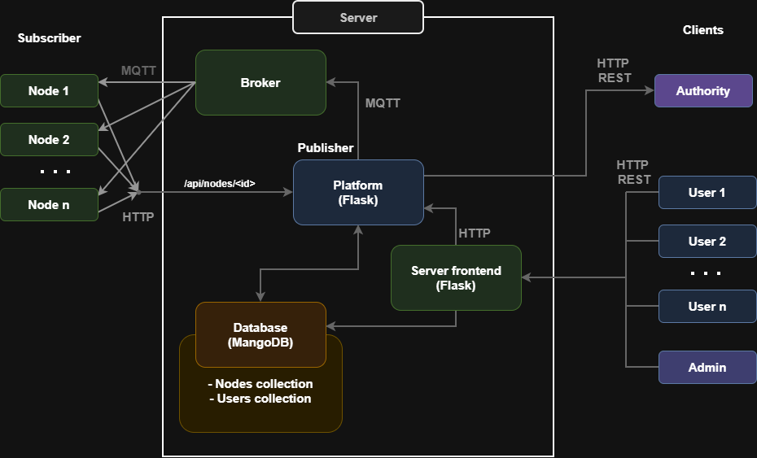
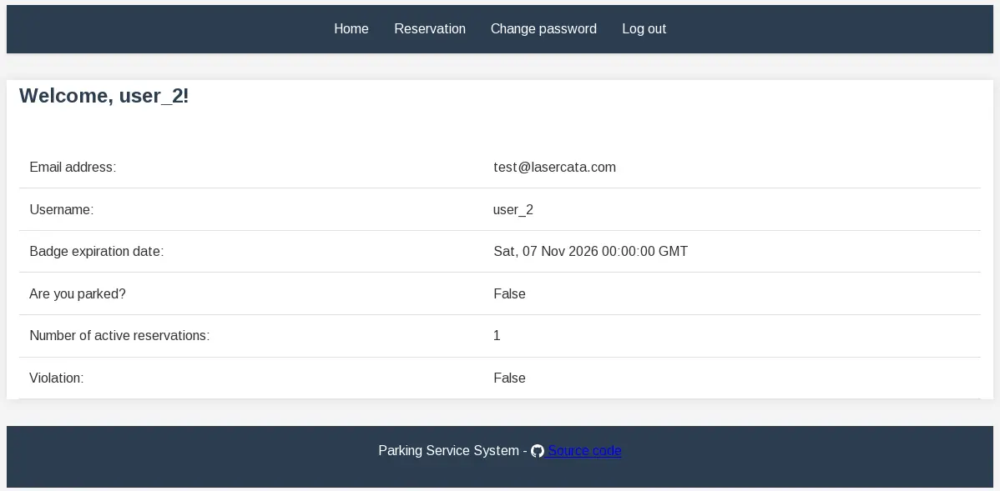
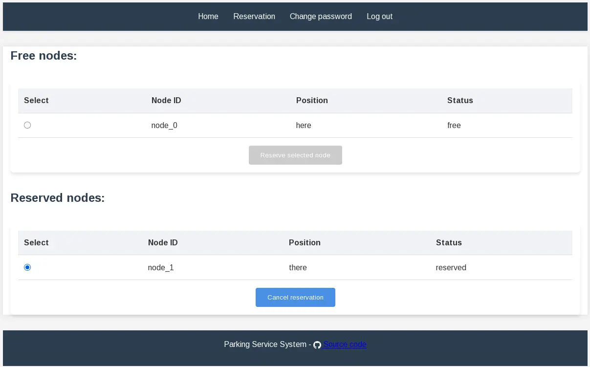
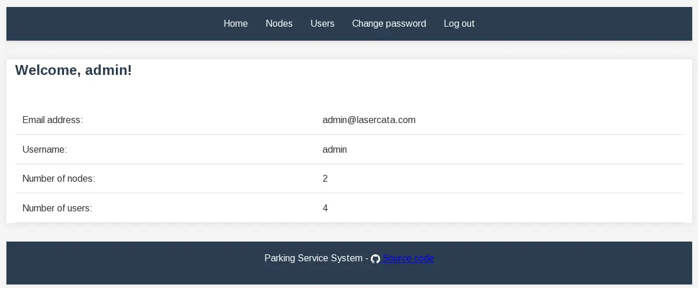
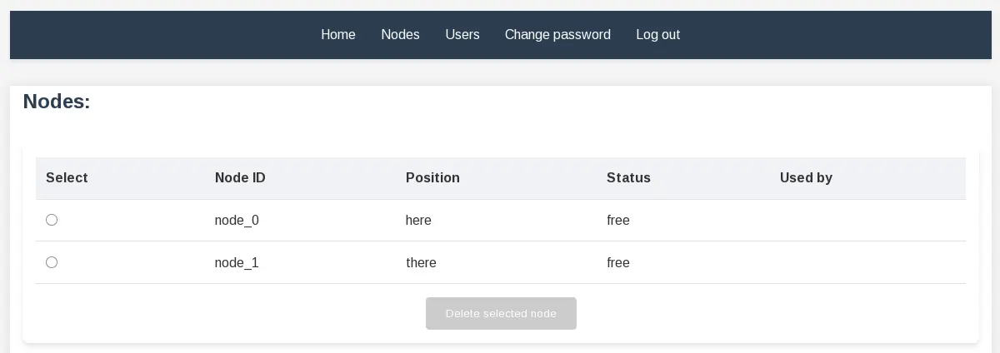
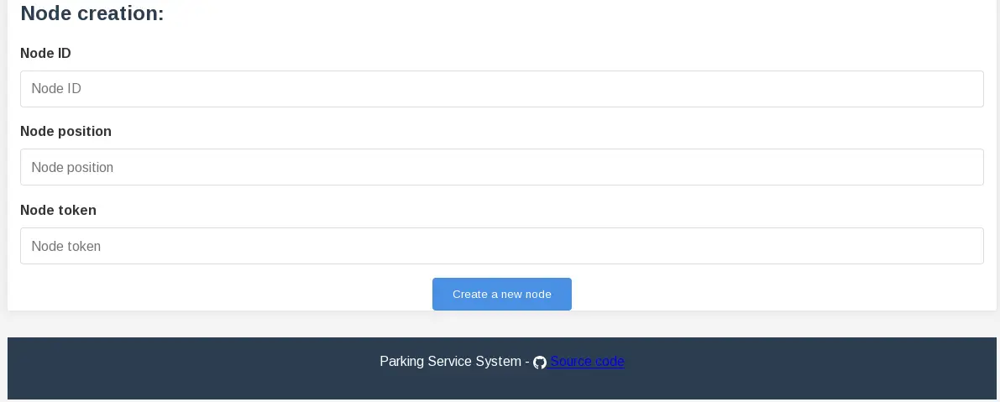
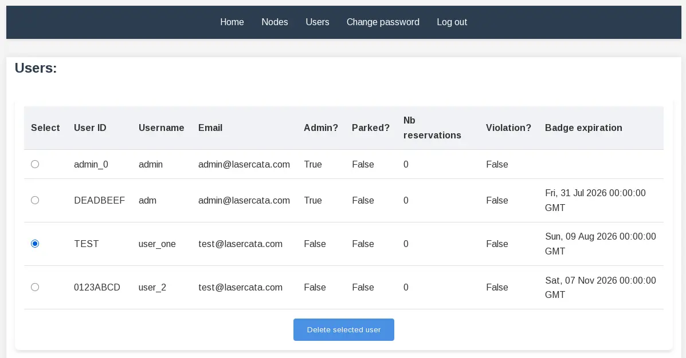
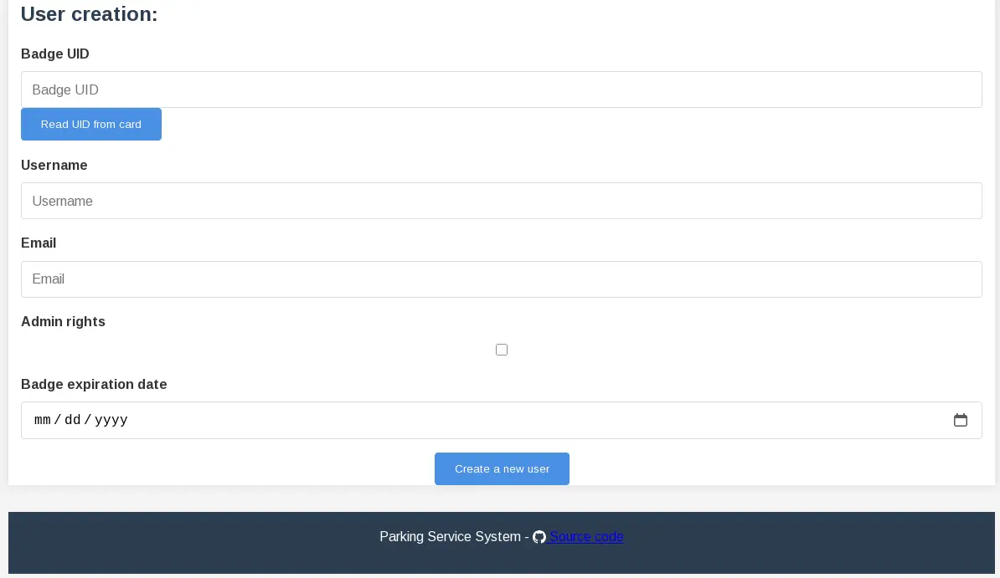
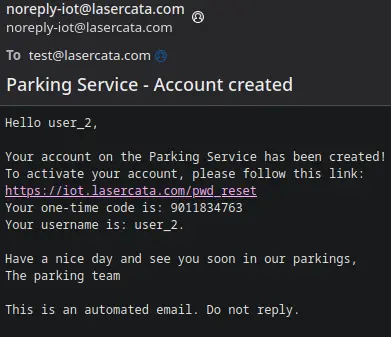

+++
title = "IoT parking management"
description = "Prototype de gestion de parking IoT"
weight = 2
date = 2026-02-18

[extra]
local_image = "/content/projects/iot_parking_management/archi_dark.png"
github = "https://github.com/github.com/iot_parking_management"
demo = "https://iot.lasercata.com/"
tags = ["iot", "python", "flask", "mqtt", "mongoDB"]
+++

Un prototype de système automatique de contrôle du stationnement, dédié aux personnes handicapées.

Chaque place de parking PMR est équipée d'un nœud IoT, qui détecte la présence d'une voiture et lit la carte d'authentification de l'utilisateur.
Il est possible de réserver une place jusqu'à une heure en avance, via une interface web sécurisée.
Le backend, appelé *IoT platform*, relie les nœuds à l'interface utilisateur et met en œuvre la logique de base.

## Architecture

## Interface web
### Utilisateur
Voici la page d'accueil pour un utilisateur :

L'onglet pour réserver une place se présente comme suit :

### Administrateur
Voici la page d'accueil d'un administrateur :

Les administrateurs peuvent gérer les nœuds :

Ils peuvent aussi gérer les utilisateurs :

Lorsqu'un administrateur crée un compte, l'utilisateur concerné reçoit un e-mail avec un code temporaire :

