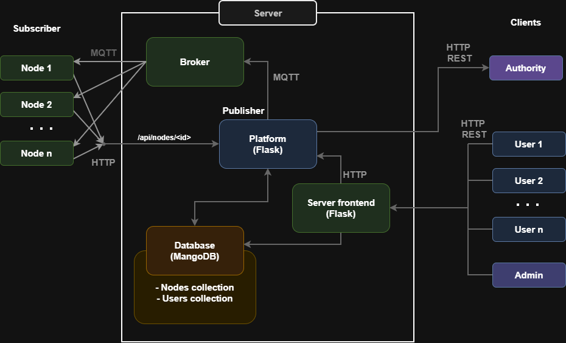
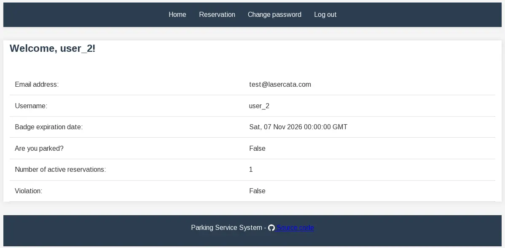
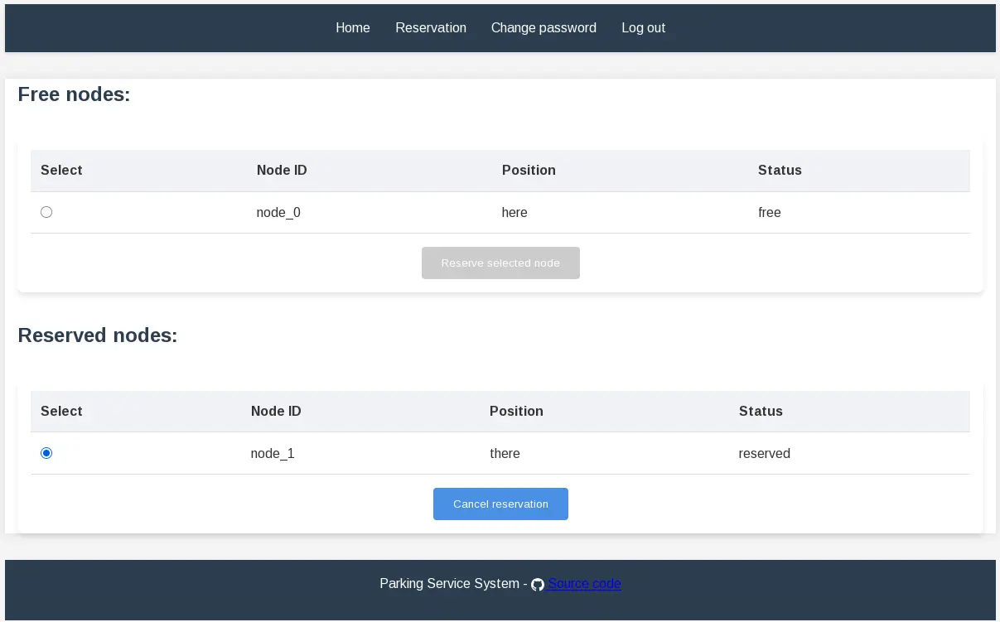
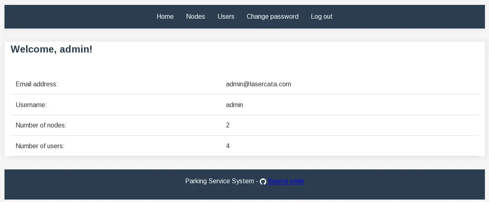
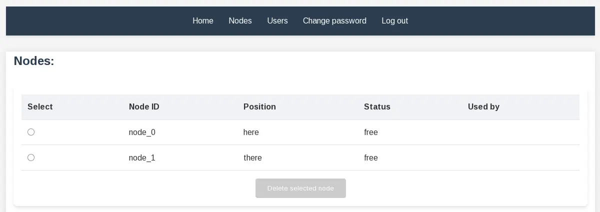
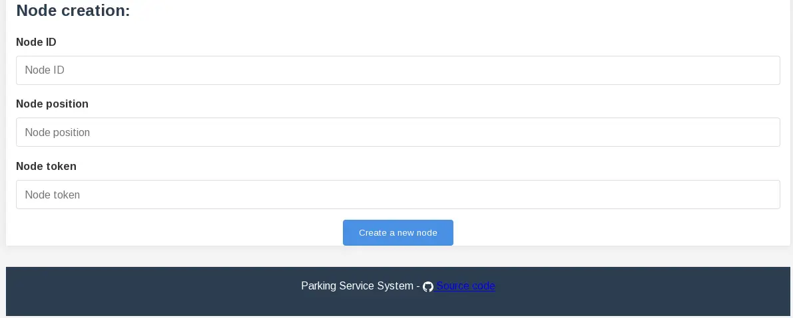
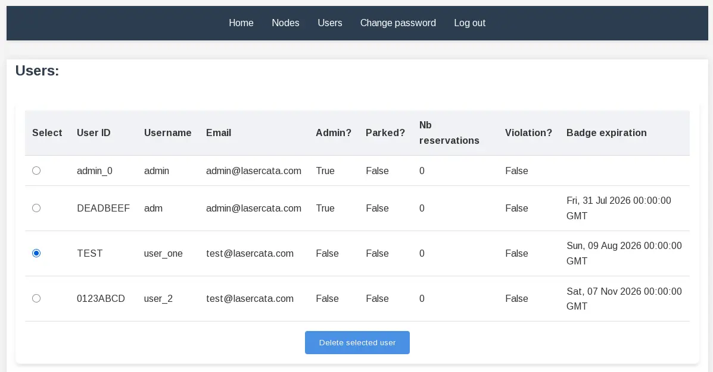
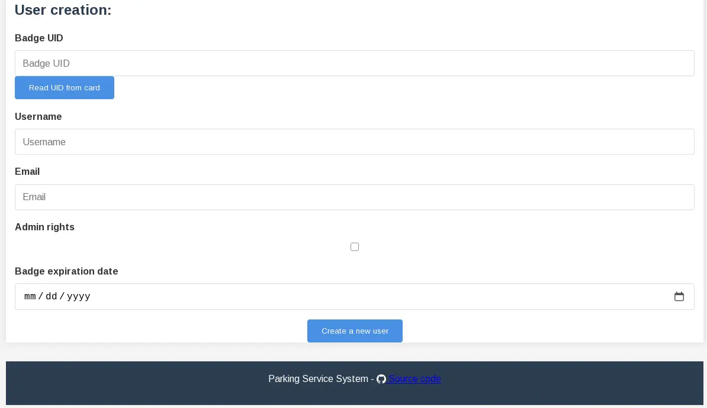
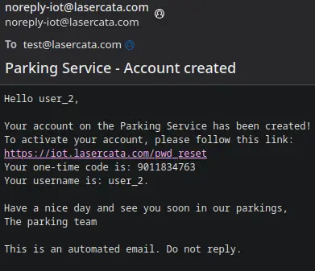

+++
title = "IoT parking management"
description = "IoT parking system prototype"
weight = 2
date = 2026-01-01

[extra]
local_image = "iot_parking_management/archi_dark.png"
github = "https://github.com/lasercata/iot_parking_management"
demo = "https://iot.lasercata.com/"
tags = ["iot", "python", "flask", "mqtt", "mongoDB"]
+++

A prototype of an automatic **parking control system** dedicated to people with disabilities.

Each parking spot is equipped with an IoT node, that detects car presence and reads user's authentication card.
The user can reserve a parking sport up to one hour in advance, via a secure web interface.
The backend, called *IoT platform*, links nodes with the user interface and implements the core logic.

## Architecture

## Showcase
### User
This is the homepage for a regular user:

And this it the reservation tab:

### Administrator
This is the homepage for administrators:

Administrators can manage nodes:

They can also manage users:

When an administrator creates an account, the user will receive an email with a temporary code:

